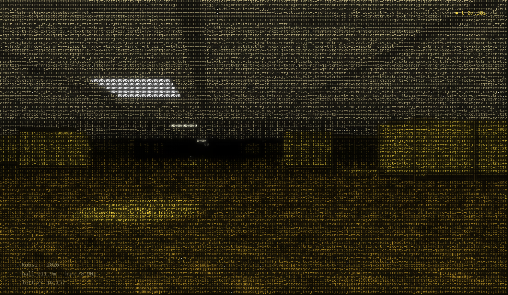

# THE BACKROOMS: LEVEL 0

Raycast yellow corridors — ASCII Code Art — Kobsi, 2026

## Artist's Note

An endless maze of damp mustard carpet, humming fluorescent panels, and yellowed damask wallpaper.
A distant green exit sign flickers down the corridor while a 60 Hz ballast hum fills the room.
Hold right-click to trigger an eerie electrical power surge through the ceiling lights.

## Technology

Python · NumPy · pygame-ce

## Creative Process

1. Raycaster: a vectorized 2D-grid raycaster casts rays from the moving camera across every column.
2. Architecture: walls, baseboards, drop-ceiling grid tiles, and damp carpet are shaded by distance and angle.
3. Lighting: overhead fluorescent panels cast pools of light and trigger a periodic or interactive power surge.
4. Audio: a synthesized 60 Hz fluorescent ballast hum and liminal drone run in real time.
5. ASCII Rendering: shaded surfaces become density-ramped characters with multi-pass bloom.

## Technical Concepts

Vectorized DDA raycasting · 60 Hz ballast synthesis · distance fog · ASCII density shading · anisotropic bloom

## Source Code

The full Python source is free and included in this folder.

`
pip install -r requirements.txt
python backroom.py
`

Space pause, R restart, S screenshot, F fullscreen, M mute, Esc quit. Left-drag to look around, hold right-click for a fluorescent surge.

Rules for using this code:
I share this code for you. Study it, change it, and use what you learn to make your own procedural and ASCII art.
Don't repost it or sell it as your own, and don't use it to train AI models.
See LICENSE.txt for full terms.
