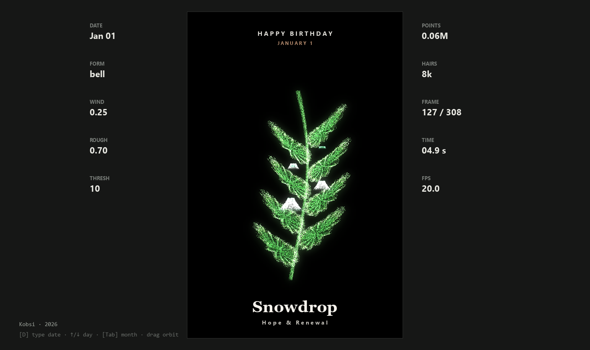

# BIRTH FLOWER

366-day botanical particle studio — Kobsi, 2026

## Artist's Note

Every calendar day maps to a botanical species, meaning, and color palette.
Thousands of glowing 3D particles assemble into stems, leaves, petals, and pollen
that sway gently in space. Type any date live to grow a different flower.

## Technology

Python · NumPy · pygame-ce

## Creative Process

1. Botanical Almanac: all 366 days map to curated flower archetypes (rose, bell, trumpet, daisy, spike, umbel, holly).
2. 3D Geometry: parametric curves and phyllotaxis spirals generate petals, stems, and foliage in 3D.
3. Animation: a progressive entrance grows the stem first, then unfurls petals and ignites pollen.
4. Interaction: live date entry, day/month stepping, and 3D orbit let you inspect any bloom.
5. Rendering: depth-sorted luminous particles with multi-pass additive bloom.

## Technical Concepts

Parametric botany · phyllotaxis · 3D rotation & projection · additive particle bloom · live date input

## Source Code

The full Python source is free and included in this folder.

`
pip install -r requirements.txt
python birth_flower.py
`

D opens date entry (e.g. Nov 15 + Enter). Up/Down change day, Tab advances month, Left/Right or left-drag orbit. Space pause, R restart, S screenshot, F fullscreen, M mute, Esc quit.

Rules for using this code:
I share this code for you. Study it, change it, and use what you learn to make your own procedural and ASCII art.
Don't repost it or sell it as your own, and don't use it to train AI models.
See LICENSE.txt for full terms.
