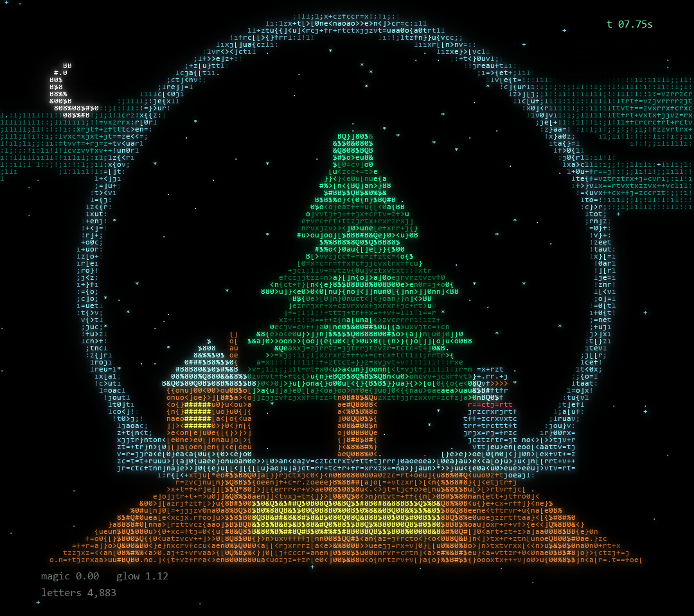

# WINTER WONDERLAND

An ASCII snow globe — Kobsi, 2026

## Artist's Note

A glass snow globe resting in a quiet winter night beneath waving northern lights.
Inside, a pine tree lights up with ornaments and garland beside a warm cabin and snowman
while snow drifts down through the dome.

## Technology

Python · NumPy · pygame-ce

## Creative Process

1. Sky & Aurora: waving northern lights ribbons, a crescent moon, and stars frame the globe.
2. Village & Tree: layered mathematical shapes build the pine tree, ornaments, cabin, and snowman.
3. Snowfall: drifting snow particles fall inside the glass dome with gentle wind.
4. Trails: a fading trail buffer softens motion across frames.
5. ASCII Rendering: density-ramped glyphs and multi-pass bloom bring the holiday lights to life.

## Technical Concepts

Signed distance shapes · aurora wave fields · trail buffers · ASCII density shading · additive bloom

## Source Code

The full Python source is free and included in this folder.

`
pip install -r requirements.txt
python christmas_tree.py
`

Space pause, R restart, S screenshot, Esc quit.

Rules for using this code:
I share this code for you. Study it, change it, and use what you learn to make your own procedural and ASCII art.
Don't repost it or sell it as your own, and don't use it to train AI models.
See LICENSE.txt for full terms.
