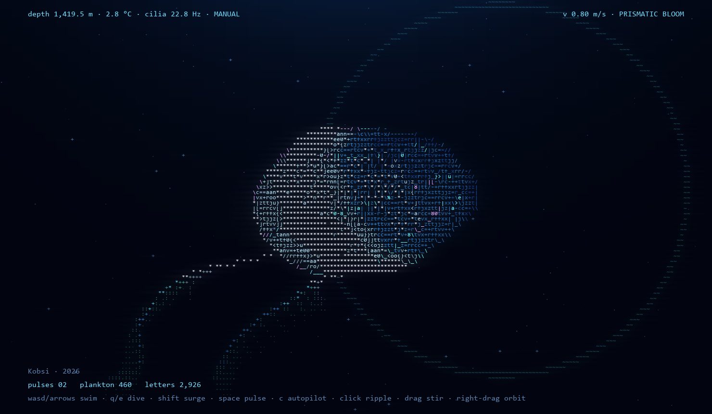

# CTENOPHORE — THE LIVING PRISM

Interactive 3D ASCII bioluminescent comb jelly — Kobsi, 2026



## Artist's Note

A translucent lobate comb jelly glides through deep abyssal water, its eight
beating comb rows diffracting electric cyan, teal, violet, and pearl light.
Pilot the creature directly through drifting bioluminescent plankton, stir
vortices in the water, and send sonar ripples that pluck crystalline chimes.

## Technology

Python · NumPy · pygame-ce

## Creative Process

1. 3D Anatomy: parametric lobate body, 8 meridian comb rows (ctenes), inner statocyst core, and 2 lacy tentacles with 18 pairs of trailing tentilla.
2. Direct Piloting & Physics: smooth underwater thrust, yaw banking, dive/ascend depth telemetry, and spring-lagged tentacle kinematics, plus an optional follow-cursor autopilot.
3. Fluid Plankton & Sonar Ripples: 460 interactive bioluminescent motes that swirl in your drag wake, glow brighter when disturbed, and boost the creature's luminescence when it swims through dense clouds.
4. Audio: a synthesized sub-aquatic C#m9 drone paired with 8 interactive crystalline glass-harp chimes triggered by prism pulses and sonar ripples.
5. ASCII & Bloom: depth-sorted 3D projection onto an ASCII glyph grid with directional silhouette outlines and anisotropic horizontal + radial bloom.

## Source Code

Run from the repository root:

```sh
pip install -r CTENOPHORE/requirements.txt
python CTENOPHORE/ctenophore.py
```

### Controls

- **Swim / Steer**: `W/S` or `Up/Down` (forward/reverse), `A/D` or `Left/Right` (yaw), `Q/E` (dive/ascend)
- **Surge**: hold `Shift` for a bioluminescent jet-surge
- **Prism Pulse**: `Space` to fire a light wave & chime
- **Autopilot**: `C` to toggle Follow-Cursor swimming
- **Mouse**: `Left-click` to drop a sonar ripple, `Left-drag` to stir water & gather plankton, `Right-drag` to orbit the 3D camera
- **Display & Audio**: `1/2/3` sea states, `P` pause, `R` reset, `S` screenshot, `F` fullscreen, `M` mute, `Esc` quit

See `LICENSE.txt` for full terms.
