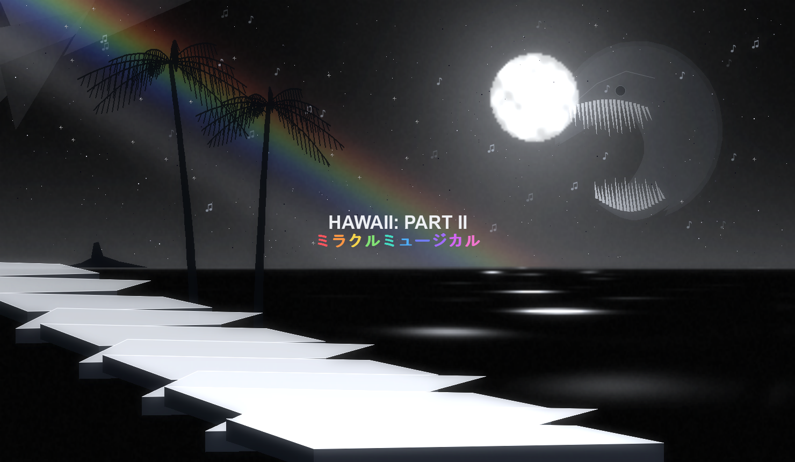

# DREAM SWEET IN SEA MAJOR

Moonlit ocean & staircase — Kobsi, 2026

## Artist's Note

A moonlit ocean, swaying palms, and a staircase rising toward the night sky,
accompanied by a synthesized 3/4 celesta waltz and rolling ocean surf.
Right-click to send a shooting star across the sky and a wave across the sea.

## Technology

Python · NumPy · pygame-ce

## Creative Process

1. Seascape: a volumetric shader renders the moonlit sky, horizon glow, and rippling ocean.
2. 3D Elements: swaying palm silhouettes, a central staircase, and celestial emblems.
3. Audio: a synthesized 3/4 celesta waltz over warm string pads and filtered ocean surf.
4. Interaction: left-drag shifts the camera view; right-click triggers a shooting star and wave.
5. Composite: additive bloom layers unite the moonlight, stars, and water reflections.

## Technical Concepts

Volumetric ocean shader · 3/4 celesta waltz synthesis · surf noise filtering · interactive shooting stars

## Source Code

The full Python source is free and included in this folder.

`
pip install -r requirements.txt
python dream_sweet.py
`

Space pause, R restart, S screenshot, F fullscreen, M mute, E toggle emblem, Esc quit. Left-drag to shift the view, right-click for a shooting star and wave.

Rules for using this code:
I share this code for you. Study it, change it, and use what you learn to make your own procedural and ASCII art.
Don't repost it or sell it as your own, and don't use it to train AI models.
See LICENSE.txt for full terms.
