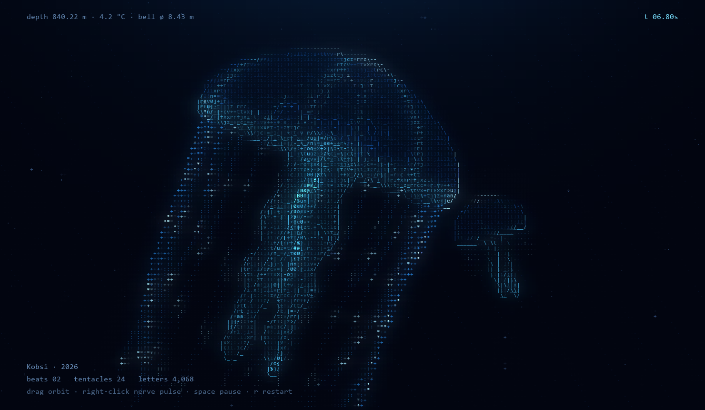

# JELLYFISH — SPEAKING IN LIGHT

Bioluminescent 3D ASCII jellyfish — Kobsi, 2026

## Artist's Note

Translucent cobalt bells drift through deep abyssal water with trailing oral arms
and twenty-four fine tentacles. Waves of electric cyan and pearl light pulse down
the radial nerves alongside a sub-aquatic C-minor 9th drone and crystalline chimes.

## Technology

Python · NumPy · pygame-ce

## Creative Process

1. 3D Anatomy: parametric bell dome, 8 radial nerve channels, 4 ruffled oral arms, and 24 tentacles.
2. Swimming Motion: contraction cycles narrow the bell and propagate delayed waves down the tentacles.
3. Bioluminescence: nerve-pulse waves travel from crown to tentacle tips, triggered automatically or by click.
4. Audio: a synthesized deep-ocean C-minor 9th drone paired with crystalline nerve-pulse chimes.
5. ASCII & Bloom: 3D points project onto an ASCII grid with anisotropic horizontal and radial bloom.

## Technical Concepts

Parametric 3D meshes · delayed wave kinematics · bioluminescent pulse propagation · ASCII projection · sonar audio

## Source Code

The full Python source is free and included in this folder.

`
pip install -r requirements.txt
python jellyfish.py
`

Space pause, R restart, S screenshot, F fullscreen, M mute, Esc quit. Left-drag to orbit camera, right-click to trigger a bioluminescent nerve pulse.

Rules for using this code:
I share this code for you. Study it, change it, and use what you learn to make your own procedural and ASCII art.
Don't repost it or sell it as your own, and don't use it to train AI models.
See LICENSE.txt for full terms.
