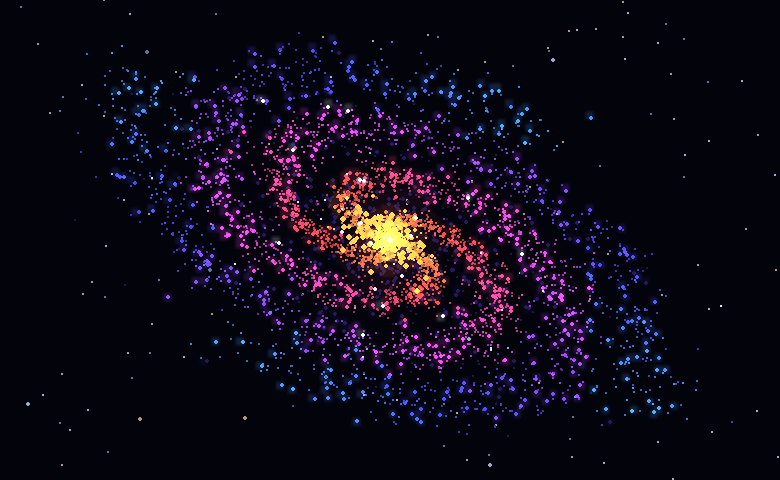
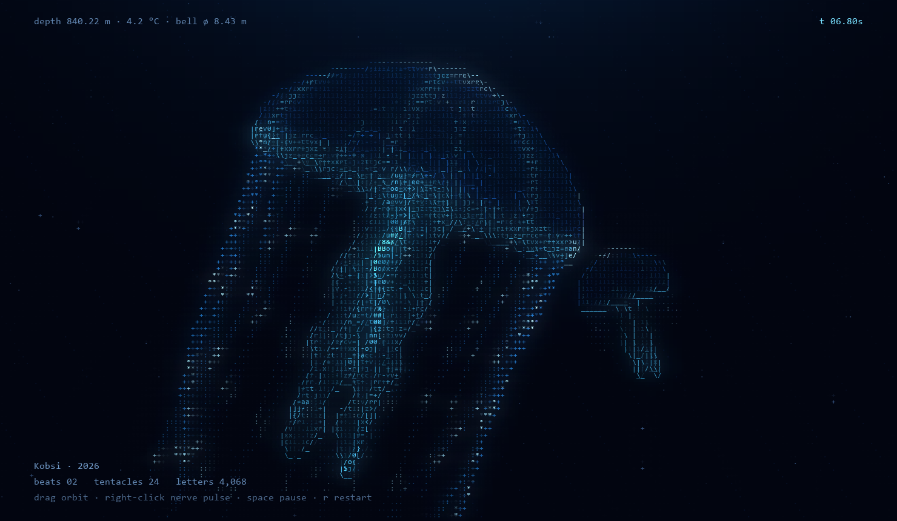
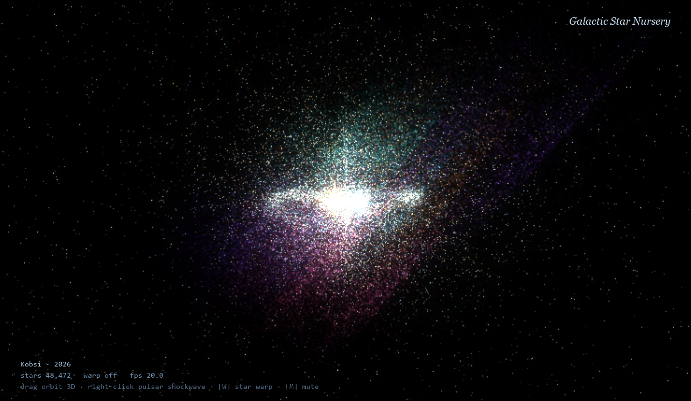
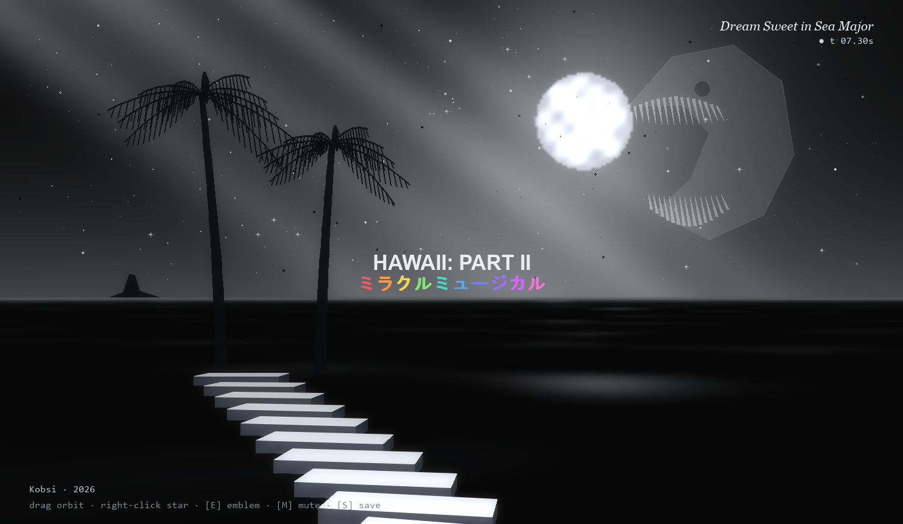
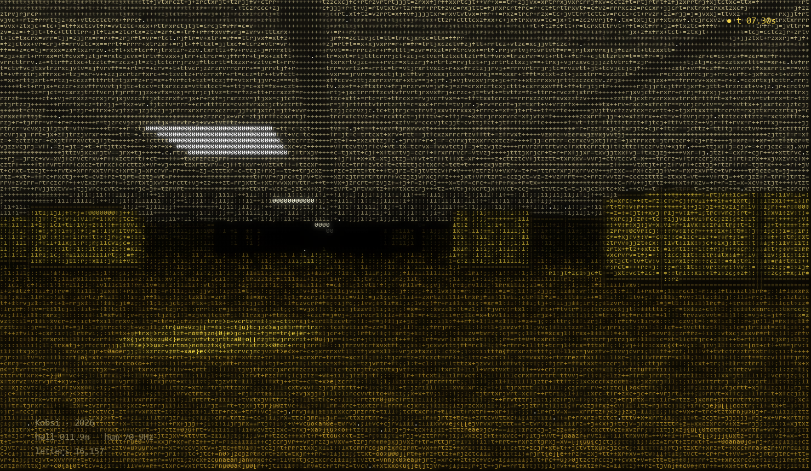
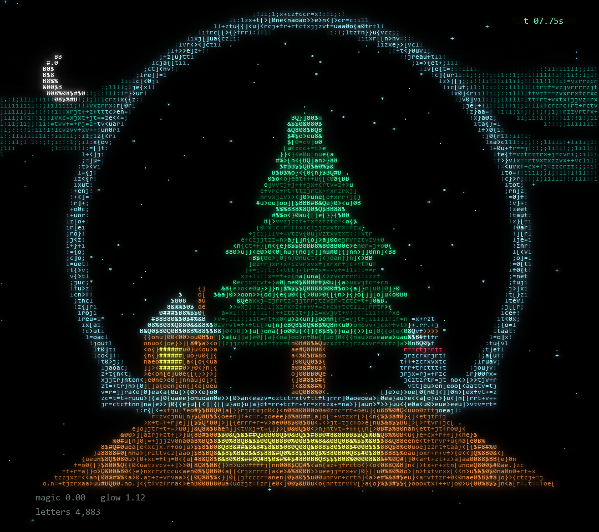

<div align="center">
  <h1>Creative Coding Lab</h1>
  <p><strong>Kobsi</strong> · Procedural worlds in Python</p>
  <p><a href="#gallery">Gallery</a> · <a href="#run-a-sketch">Run a sketch</a> · <a href="#controls">Controls</a></p>
  <a href="spiral_galaxy_pygame.py"></a>
  <p><strong>Spiral Galaxy</strong> · A rotating particle study with a layered reveal.</p>
</div>

## Gallery

I make small animated worlds with ASCII glyphs, particles, light, and synthesized sound. Each sketch runs on its own.

| | |
| :--- | :--- |
| [](JellyFish1.py)<br>**[Jellyfish](JellyFish1.py)**<br>Bioluminescent bells, trailing tentacles, and sonar in deep blue water. | [](Star%20nursery.py)<br>**[Galactic Star Nursery](Star%20nursery.py)**<br>A 3D fly-through of nebulae, forming stars, and cosmic bursts. |
| [](Dream.py)<br>**[Dream Sweet in Sea Major](Dream.py)**<br>A moonlit seascape with palms, a staircase, and a synthesized score. | [](BirthFlower.py)<br>**[Birth Flower](BirthFlower.py)**<br>A date selects a flower assembled from glowing 3D particles. |
| [](Backroom.py)<br>**[Backroom](Backroom.py)**<br>Raycast corridors, flickering fluorescents, and an electrical drone. | [](christmas_tree.py)<br>**[Christmas Tree](christmas_tree.py)**<br>A winter snow globe with falling snow, ornaments, and an aurora. |

[Spiral Galaxy in Turtle](spiral_galaxy_turtle.py) is a still study of the same four-arm motif, drawn dot by dot.

## Run a sketch

From the repository root, create a virtual environment and install the dependencies. These sketches use NumPy and pygame-ce, which provides the `pygame` import.

**Windows PowerShell**

```powershell
py -3 -m venv .venv
.\.venv\Scripts\python.exe -m pip install -r requirements.txt
```

**macOS, Linux, or WSL**

```sh
python3 -m venv .venv
source .venv/bin/activate
python -m pip install -r requirements.txt
```

Run any one of these commands. In PowerShell, replace `python` with `.\.venv\Scripts\python.exe`.

| Sketch | Command |
| :--- | :--- |
| Spiral Galaxy | `python spiral_galaxy_pygame.py` |
| Jellyfish | `python JellyFish1.py` |
| Galactic Star Nursery | `python "Star nursery.py"` |
| Dream Sweet in Sea Major | `python Dream.py` |
| Birth Flower | `python BirthFlower.py` |
| Backroom | `python Backroom.py` |
| Christmas Tree | `python christmas_tree.py` |
| Spiral Galaxy in Turtle | `python spiral_galaxy_turtle.py` |

WSL needs WSLg or a working X server. The Turtle study uses the standard library and needs Tk (on Debian or Ubuntu, install `python3-tk`).

## Controls

In the Pygame sketches, press **Space** to pause, **R** to restart, **S** to save a PNG beside the script, or **Esc** to exit. Close the Turtle window to exit. **M** toggles sound and **F** toggles fullscreen in Jellyfish, Galactic Star Nursery, Dream, Birth Flower, and Backroom.

| Sketch | Additional controls |
| :--- | :--- |
| Jellyfish | **Left-drag** to orbit. **Right-click** to send a pulse through the bell. |
| Galactic Star Nursery | **Left-drag** to look around. **Right-click** for a cosmic burst. **W** toggles warp. |
| Dream Sweet in Sea Major | **Left-drag** to shift the view. **Right-click** for a shooting star and a wave. **E** toggles the emblem. |
| Birth Flower | **D** opens date entry. Type a date such as `Nov 15` and press **Enter**. **Up/Down** change the day, **Tab** advances the month, and **Left/Right** or **left-drag** orbit. |
| Backroom | **Left-drag** to look around. Hold **right-click** for a fluorescent surge. |
