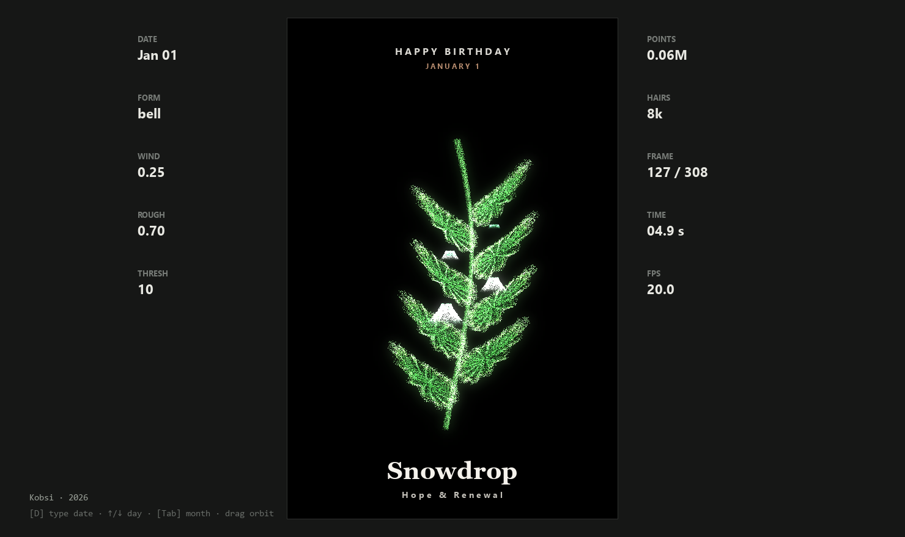
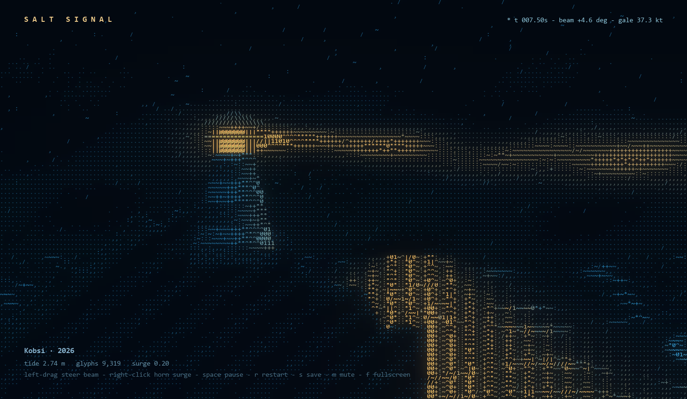

# Kobsi — Procedural & ASCII Code Art

Kobsi (`@Kobsi17`) is a creative coding artist who builds self-contained animated worlds in Python using ASCII glyphs, 3D particles, volumetric light, and procedurally synthesized sound.

This repository is an archive of the works and a technical portfolio: what each piece is, how it was made, and the full source code.

## Works

| | Work | Year | Source code |
|---|---|---|---|
|  | [SPIRAL GALAXY](SPIRAL-GALAXY/) | 2026 | free, in this repository |
|  | [JELLYFISH (Speaking in Light)](JELLYFISH/) | 2026 | free, in this repository |
|  | [GALACTIC STAR NURSERY](STAR-NURSERY/) | 2026 | free, in this repository |
|  | [DREAM SWEET IN SEA MAJOR](DREAM-SWEET-IN-SEA-MAJOR/) | 2026 | free, in this repository |
|  | [BIRTH FLOWER](BIRTH-FLOWER/) | 2026 | free, in this repository |
|  | [THE BACKROOMS: LEVEL 0](BACKROOM/) | 2026 | free, in this repository |
|  | [WINTER WONDERLAND](CHRISTMAS-TREE/) | 2026 | free, in this repository |
|  | [SALT SIGNAL](SALT-SIGNAL/) | 2026 | free, in this repository |

## Run a Sketch

From the repository root, create a virtual environment and install the dependencies (`numpy` and `pygame-ce`, which provides the `pygame` import):

**Windows PowerShell**

```powershell
py -3 -m venv .venv
.\.venv\Scripts\python.exe -m pip install -r requirements.txt
```

**macOS / Linux**

```sh
python3 -m venv .venv
source .venv/bin/activate
python -m pip install -r requirements.txt
```

Then run any piece from its folder, for example:

```sh
python SALT-SIGNAL/salt_signal.py
```

Each folder contains the full script, `HOW_IT_WORKS.txt`, `README.md`, `README.txt`, `requirements.txt`, `LICENSE.txt`, and `images/`.

## Pixel Corner Lab

Play Spiral Galaxy in the browser and preview your own JavaScript or self-contained HTML sketches. Start the site from the repository root:

```sh
python -m http.server 8000 --bind 127.0.0.1 --directory sites/pixel-corner-lab/dist
```

Open [Pixel Corner Lab](http://127.0.0.1:8000/). Use **Play galaxy** to start the animation and **Pause galaxy** to freeze it. Paste code or use **Open file**, select the matching format, then choose **Run sketch**. **Stop sketch** closes the preview and returns to Spiral Galaxy. **Download source** saves the current editor contents. **Full screen** expands the preview where the browser supports it.

The site needs no additional packages. The editor runs JavaScript and self-contained HTML in a sandboxed preview. Desktop Python/Pygame sketches still use the desktop setup above unless ported for the browser.

[Spiral Galaxy preview](sites/pixel-corner-lab/dist/galaxy/poster.png)

## License

Kobsi · `@Kobsi17` · 2026. Free for learning and personal projects. See [LICENSE.txt](LICENSE.txt).
Don't repost it or sell it as your own, and don't use it to train AI models.
