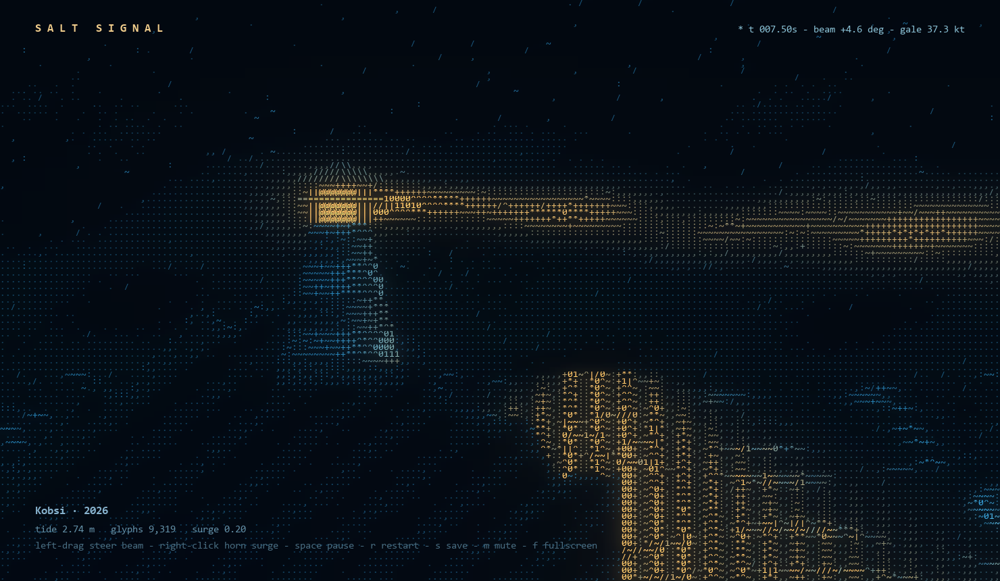

# SALT SIGNAL

Storm coast lighthouse — ASCII Code Art — Kobsi, 2026

## Artist's Note

A lone stone lighthouse perched on a dark basalt cliff above a storm-tossed sea.
An amber beam sweeps through drifting marine fog and slanting rain, catching broken
silver reflections on the waves while a synthesized coastal gale and foghorn sound.

## Technology

Python · NumPy · pygame-ce

## Creative Process

1. Progressive Entrance: stars and fog appear first, then cliffs, waves, and tower, then the lantern ignites.
2. Coastal Field: multi-scale drifting fog, slanting rain, and logarithmic perspective ocean waves.
3. Volumetric Beam: an amber light cone scatters through the fog and reflects across wave crests.
4. Audio: procedural coastal wind gusts, breaking surf, a D-minor drone, celesta chimes, and a foghorn.
5. ASCII & Bloom: glyphs map onto a 1480x860 canvas with a fading trail buffer and anisotropic bloom.

## Technical Concepts

Volumetric beam scattering · perspective wave fields · procedural gale & foghorn synthesis · trail buffers · anisotropic bloom

## Source Code

The full Python source is free and included in this folder.

`
pip install -r requirements.txt
python salt_signal.py
`

Space pause, R restart, S screenshot, F fullscreen, M mute, Esc quit. Left-drag to steer the beam, right-click to blast the foghorn and trigger a storm surge.

Rules for using this code:
I share this code for you. Study it, change it, and use what you learn to make your own procedural and ASCII art.
Don't repost it or sell it as your own, and don't use it to train AI models.
See LICENSE.txt for full terms.
