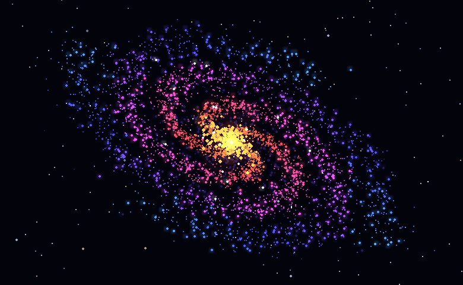

# SPIRAL GALAXY

Four-arm rotating particle study — Kobsi, 2026

## Artist's Note

Four logarithmic spiral arms of blue and magenta stars swirling around a warm golden
galactic core, tilted in perspective against a field of distant background stars.
The galaxy builds itself particle by particle before settling into steady rotation.

## Technology

Python · pygame-ce

## Creative Process

1. Starfield: stationary background stars, galactic dust, four spiral arms, and a bright core.
2. Logarithmic Spirals: stars are distributed along four arms with radial scatter and HSV color gradients.
3. Layered Reveal: thousands of particles stream into view at a steady rate.
4. Perspective Tilt: each star orbits in the galactic plane and projects with a 0.45 rad tilt.

## Technical Concepts

Logarithmic spiral arms · HSV color gradients · 3D plane tilt projection · progressive particle reveal

## Source Code

The full Python source is free and included in this folder.

`
pip install -r requirements.txt
python spiral_galaxy.py
`

Space pause, R restart, S screenshot, Esc quit.

Rules for using this code:
I share this code for you. Study it, change it, and use what you learn to make your own procedural and ASCII art.
Don't repost it or sell it as your own, and don't use it to train AI models.
See LICENSE.txt for full terms.
