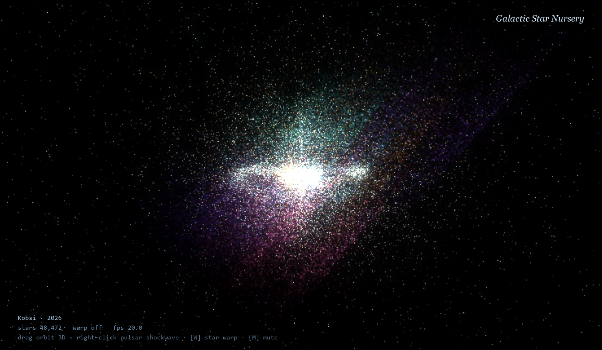

# GALACTIC STAR NURSERY

3D nebula fly-through & cosmic bursts — Kobsi, 2026

## Artist's Note

A 3D fly-through of glowing nebulae, binary star nurseries, and forming protostars
set to a 36-second Lydian space drone and celestial harp arpeggio.
Right-click to ignite a cosmic burst or press W to engage warp speed.

## Technology

Python · NumPy · pygame-ce

## Creative Process

1. 3D Starfield & Nebulae: volumetric particle clouds form glowing filaments and binary cores.
2. Camera Fly-Through: continuous forward motion with interactive look-around and warp mode.
3. Cosmic Bursts: right-clicking triggers an expanding shockwave of newly ignited starlight.
4. Audio: a synthesized Lydian space drone with celestial harp arpeggios and burst chimes.

## Technical Concepts

3D particle fly-through · volumetric nebula clouds · Lydian synth & harp synthesis · warp & burst dynamics

## Source Code

The full Python source is free and included in this folder.

`
pip install -r requirements.txt
python star_nursery.py
`

Space pause, R restart, S screenshot, F fullscreen, M mute, W toggle warp, Esc quit. Left-drag to look around, right-click for a cosmic burst.

Rules for using this code:
I share this code for you. Study it, change it, and use what you learn to make your own procedural and ASCII art.
Don't repost it or sell it as your own, and don't use it to train AI models.
See LICENSE.txt for full terms.
